# 08. Database Relationships & ER Diagram

> Relational graph, foreign-key deletion semantics, and composite database indexes.

---

## 8.1 Entity-Relationship Diagram

```mermaid
erDiagram
    User ||--o| MemberProfile : "1:1"
    User ||--o| TrainerProfile : "1:1"
    User ||--o{ RefreshToken : "owns"
    User ||--o{ Notification : "receives"
    User ||--o{ AuditLog : "performs"
    User ||--o{ CrmLead : "assigned leads"
    User ||--o{ CrmActivity : "logs"

    TrainerProfile ||--o{ MemberProfile : "coaches"
    TrainerProfile ||--o{ WorkoutProgram : "authors"
    TrainerProfile ||--o{ ClassSchedule : "instructs"
    TrainerProfile ||--o{ SessionTrainerAssignment : "assigned"
    TrainerProfile ||--o{ TrainerAttendance : "checks in"

    MembershipPlan ||--o{ Membership : "defines"
    MemberProfile ||--o{ Membership : "subscribes"
    Membership ||--o| Membership : "renews from"

    MemberProfile ||--o{ Payment : "pays"
    Membership ||--o{ Payment : "billed for"
    Payment ||--o| PaymentReceipt : "issues"

    WorkoutProgram ||--o{ WorkoutExercise : "contains"
    Exercise ||--o{ WorkoutExercise : "used in"
    MemberProfile ||--o{ MemberWorkoutAssignment : "assigned"
    WorkoutProgram ||--o{ MemberWorkoutAssignment : "template for"

    GymClass ||--o{ ClassSchedule : "scheduled as"
    ClassSchedule ||--o{ Booking : "booked via"
    MemberProfile ||--o{ Booking : "reserves"
    ClassSchedule ||--o{ Attendance : "tracks"
    Booking ||--o| Attendance : "verifies"

    MemberProfile ||--o| BiometricEnrollment : "1:1 consent"
    MemberProfile ||--o{ AccessEvent : "access attempts"
    AccessDevice ||--o{ AccessEvent : "emits"
    AccessDevice ||--o{ DoorControllerEvent : "triggers"
    GymSession ||--o{ SessionTrainerAssignment : "staffs"
    GymSession ||--o{ TrainerAttendance : "records"
    GymSession ||--o{ GymSessionException : "overrides"

    StoreOrder ||--o{ StoreOrderItem : "contains"
    StoreProduct ||--o{ StoreOrderItem : "ordered as"

    HrmEmployee ||--o{ HrmSalaryPayment : "paid monthly"

    CrmLead ||--o{ CrmActivity : "follow-up log"
    MemberProfile ||--o{ CrmActivity : "retention log"
```

---

## 8.2 Key Relational Constraints & Unique Indexes

| Domain                   | Constraint / Index                                             | Purpose                                                       |
| :----------------------- | :------------------------------------------------------------- | :------------------------------------------------------------ |
| **Identity**             | `User.email` (`UNIQUE`), `User.phone` (`UNIQUE`)               | Prevents duplicate accounts across login channels             |
| **Profiles**             | `MemberProfile.memberCode` (`UNIQUE`, `IFG-YYYY-XXXX`)         | Unique gym student ID for POS & Store verification            |
| **Cascades (Auth)**      | `MemberProfile.userId` & `TrainerProfile.userId` (`CASCADE`)   | Profile lifecycle bound 1:1 to `User`                         |
| **Financial Preservation**| `Membership.memberProfileId` & `Payment.memberProfileId` (`RESTRICT`) | Prevents orphaned billing or subscription history     |
| **Renewal Lineage**      | `Membership.previousMembershipId` (`SET NULL`)                 | Preserves chronological package renewal history               |
| **Receipts**             | `PaymentReceipt.paymentId` & `receiptNumber` (`UNIQUE`)        | One immutable verifiable receipt per verified payment         |
| **Class Concurrency**    | `Booking @@unique([classScheduleId, memberProfileId, sessionDate])` | Prevents duplicate class reservations at DB level        |
| **Attendance**           | `Attendance @@unique([classScheduleId, memberProfileId, sessionDate])` | One attendance record per member per session         |
| **Biometrics & Gate**    | `BiometricEnrollment.templateHash` (`UNIQUE`), `AccessEvent.idempotencyKey` (`UNIQUE`) | Instant digest match & replay deduplication |
| **Trainer Check-In**     | `TrainerAttendance @@unique([trainerProfileId, gymSessionId, sessionDate])` | One physical check-in row per trainer per session |
| **Store & Stock**        | `StoreOrderItem.orderId` (`CASCADE`), `productId` (`RESTRICT`) | Preserves product history while cleaning up cancelled orders |
| **HRM Payroll**          | `HrmSalaryPayment @@unique([employeeId, monthKey])`            | Prevents duplicate salary disbursement for the same month     |
| **CRM De-Duplication**   | `CrmLead.sourceInquiryId` (`UNIQUE`)                           | Prevents importing the same `ContactInquiry` twice            |

---

← [07. Database Schema](./DATABASE_SCHEMA.md) · Next: [09. API Documentation →](./API_DOCUMENTATION.md)
