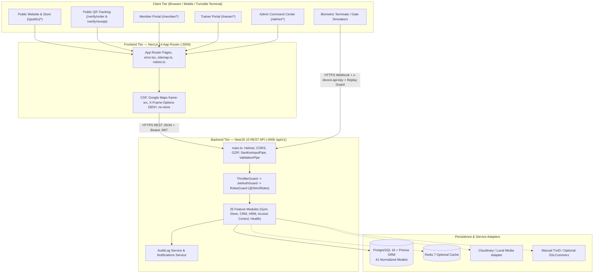

# 04. System Architecture

> High-level topology, request security pipeline, transactional boundaries, and JSON envelope standards.

---

## 4.1 High-Level Architecture Diagram



---

## 4.2 Architectural Principles

- **Strict Separation of Concerns**
  - `frontend/` manages UI rendering, SEO metadata, Dual-Theme styling (`ThemeContext`), Canvas PNG Cash Memo slip generation, QR matrix rendering, and portal routing.
  - `backend/` owns **100%** of business rules, BDT totals/shipping/discounts, `Asia/Dhaka` cutoff math, authentication, hybrid RBAC, and transactional persistence.
- **Defense-in-Depth Security**
  - Startup check (`validateSecurityEnvironment`) fails closed outside `NODE_ENV=test` if `JWT_ACCESS_SECRET`, `JWT_REFRESH_SECRET` (distinct), `BIOMETRIC_ENCRYPTION_KEY`, or `BIOMETRIC_HASH_SALT` are missing, weak, or under `32` chars.
  - Every private request traverses `ThrottlerGuard` (`120 req/min` + tight route overrides) → `JwtAuthGuard` (rejecting suspended/deleted accounts) → `RolesGuard` (`@Roles`, `@StrictRoles()`, and `@RequirePermission`).
  - Service-layer IDOR checks isolate Member self-routes and redact KYC/biometric records from Trainers.
- **Transactional Atomicity**
  - Registration, Payment verification + receipt + membership activation, Class booking capacity locks, Store order inventory decrements, and Biometric erasure execute inside `prisma.$transaction()`.
- **Clean External Adapters**
  - Biometric hardware terminals (`HardwareAdapterService`), Cloudinary media, Redis, and SSLCommerz operate cleanly in simulated/manual fallback modes when disabled.

---

## 4.3 Security Headers, GZIP & Health Probe

- **Backend (`main.ts`):** `Helmet` (`defaultSrc: none`, `frameAncestors: none`, HSTS on HTTPS), `trust proxy: 1`, `x-powered-by` disabled, CORS allowlist, and zero-dependency GZIP compression on `/api/v1` JSON payloads `>= 1 KB`.
- **Frontend (`next.config.mjs`):** Strict CSP (allowing Google Maps embeds on `/contact` via `frame-src 'self' https://www.google.com https://maps.google.com`), `camera=(self)` Permissions-Policy for Face ID enrollment, plus `X-Robots-Tag: noindex, nofollow` and `Cache-Control: private, no-store` on portals.
- **Readiness Endpoint:** `GET /api/v1/health` executes `SELECT 1` against PostgreSQL and responds `200 OK` or `503 Service Unavailable`.

---

## 4.4 Standardized JSON Envelope

```json
// Success Response
{
  "success": true,
  "message": "Operation completed successfully",
  "data": { "...": "..." },
  "meta": { "page": 1, "limit": 20, "total": 142, "totalPages": 8 },
  "timestamp": "2026-11-16T12:00:00.000Z"
}
```

```json
// Error Response
{
  "success": false,
  "statusCode": 400,
  "error": "Bad Request",
  "message": "Class session has reached maximum capacity (20/20).",
  "path": "/api/v1/bookings",
  "timestamp": "2026-11-16T12:00:00.000Z"
}
```

---

← [03. Design System](./DESIGN_SYSTEM.md) · Next: [05. Frontend Structure →](./FRONTEND_STRUCTURE.md)
